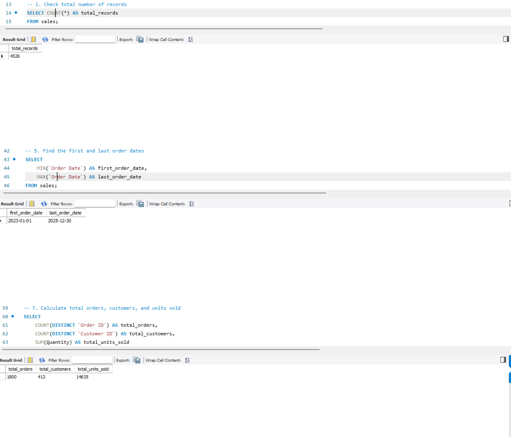
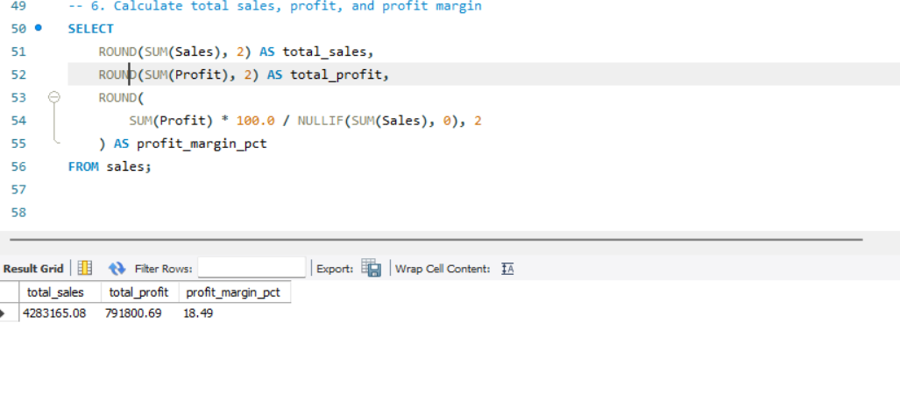
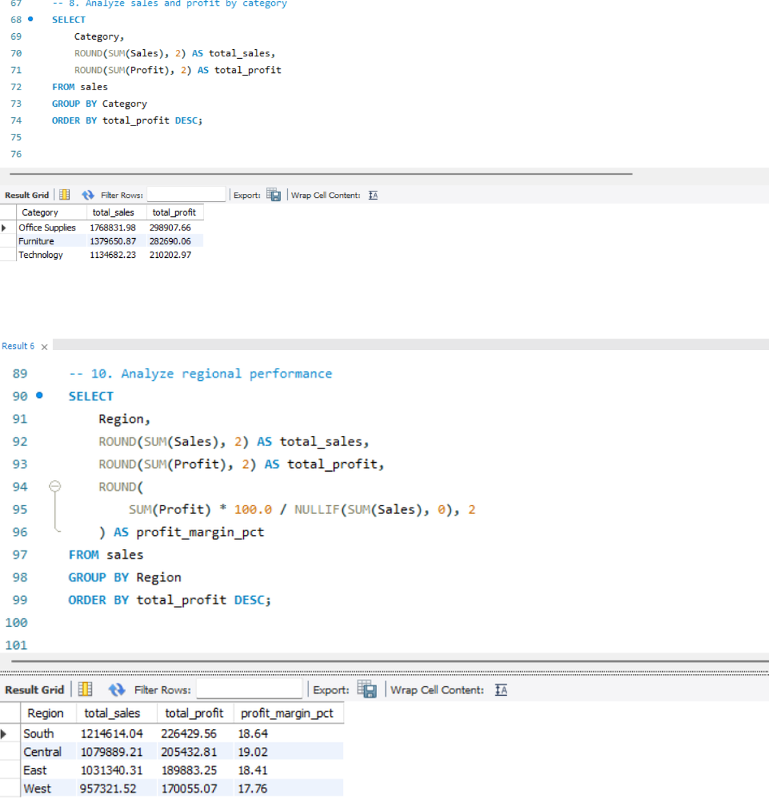
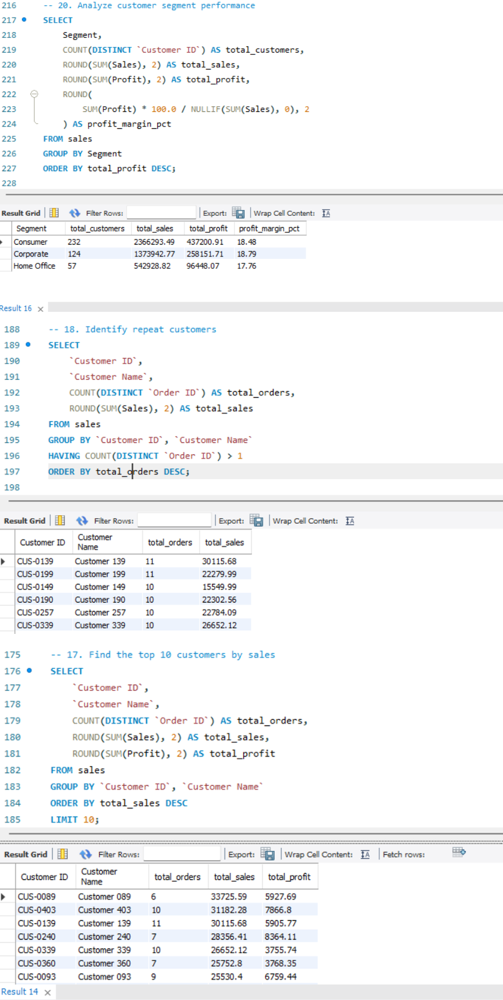
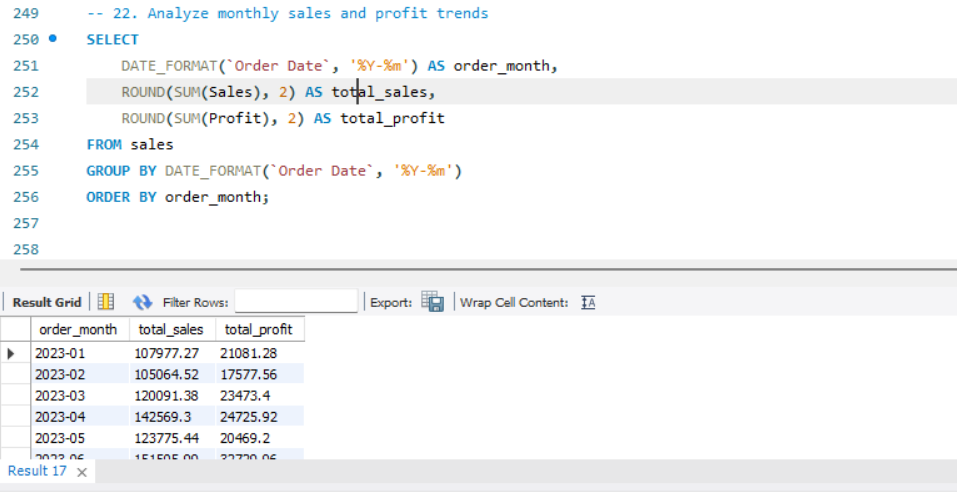

# 📊 Retail Sales, Customer Behavior and Profit Analysis Using SQL

## 📌 Project Overview
Analyzed retail sales data using MySQL to understand customer behavior, sales performance, discount impact, and product profitability.

## 🛠️ Tools Used
- MySQL
- MySQL Workbench
- SQL

## 🎯 Key Analysis
- Sales, profit, and profit margin analysis
- Customer and repeat purchase analysis
- Category and regional performance
- Discount impact and loss-making products
- Monthly sales and profit trends
- Product and customer ranking using window functions

## 📸 Project Screenshots

## 📸 Project Screenshots

### 1. Dataset Overview

### 2. Sales and Profit Analysis

### 3. Category and Regional Analysis

### 4. Customer Behavior Analysis

### 5. Monthly Trend Analysis

## 💻 SQL Concepts
`GROUP BY` | `HAVING` | Aggregate Functions | Subqueries | `CASE` | `RANK()` 

## 📂 Project Structure
- `SQL/` — SQL analysis queries
- `Dataset/` — Sample retail dataset
- `Screenshots/` — SQL query outputs

## 💡 Outcome
Identified unprofitable products, analyzed discount-related losses, and evaluated customer and regional performance to support better business decisions.

## 📁 Dataset
Sample synthetic retail data containing order, customer, product, sales, discount, and profit information.

## 👨‍💻 Author
**Omkar Nivangune**  
Aspiring Data Analyst

**Skills:** SQL | MySQL | Data Analysis

